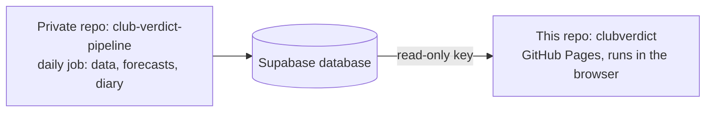

# Club Verdict website: documentation

**Club Verdict** is a football stats site for **LaLiga** and the **Premier League**, published with GitHub Pages from this repository. It is one static page (`index.html`) that reads live data from the Supabase database.

The data comes from a daily job in the private repo `sergiorozalen/club-verdict-pipeline`, documented in that repo's `docs/` folder (architecture, database, forecast model, Season diary, operations).

## How it fits together



This repo is the shop window: one page with no heavy work. The browser fetches everything live from Supabase and draws it. The engine is the private pipeline repo; its `docs/Architecture.md` has the full diagram and a plain-words overview.

## Pages

| Page | What it covers |
|---|---|
| [Features](Features.md) | The four tabs (Clubs, Matchday, Tables, Explorer) and what every number means |
| [How the site gets its data](Data.md) | Live layer, the embedded snapshot, which database views each tab reads |
| [Editing and publishing](Editing.md) | How to change the page, test it and publish it |

## Repository layout

```
index.html    the whole site: HTML, CSS, JavaScript and an embedded data snapshot
.nojekyll     tells GitHub Pages to serve files as they are
docs/         this documentation
```
